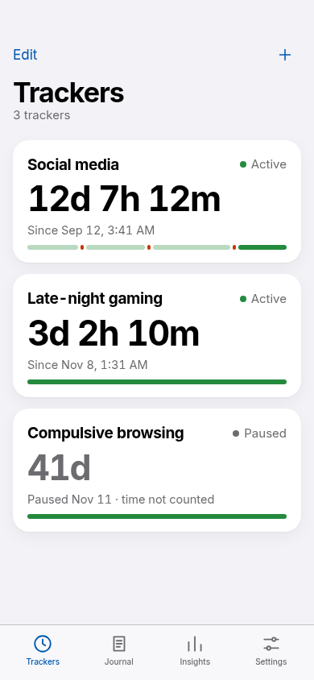
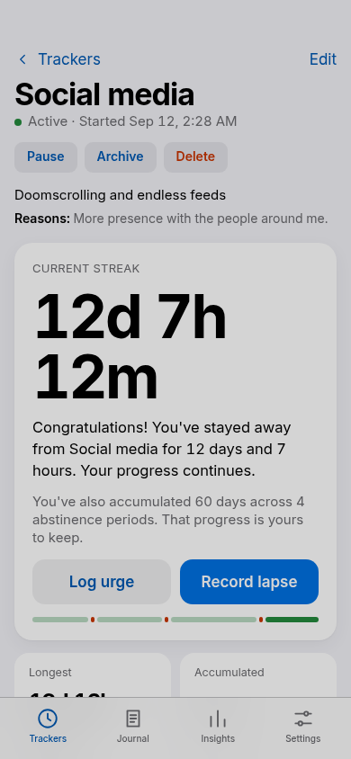
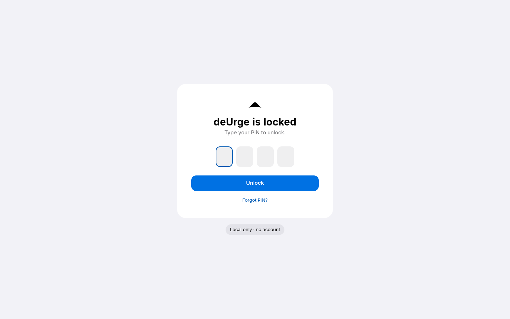
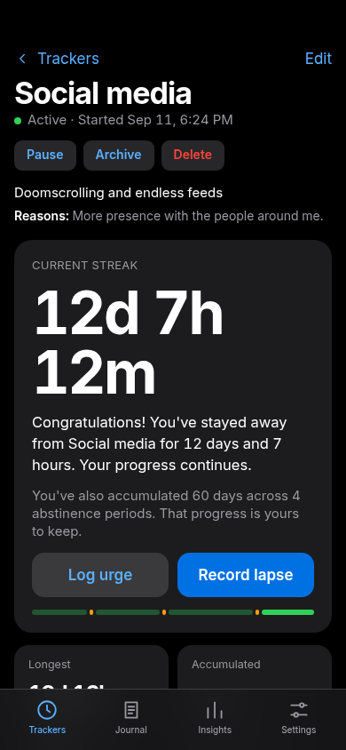
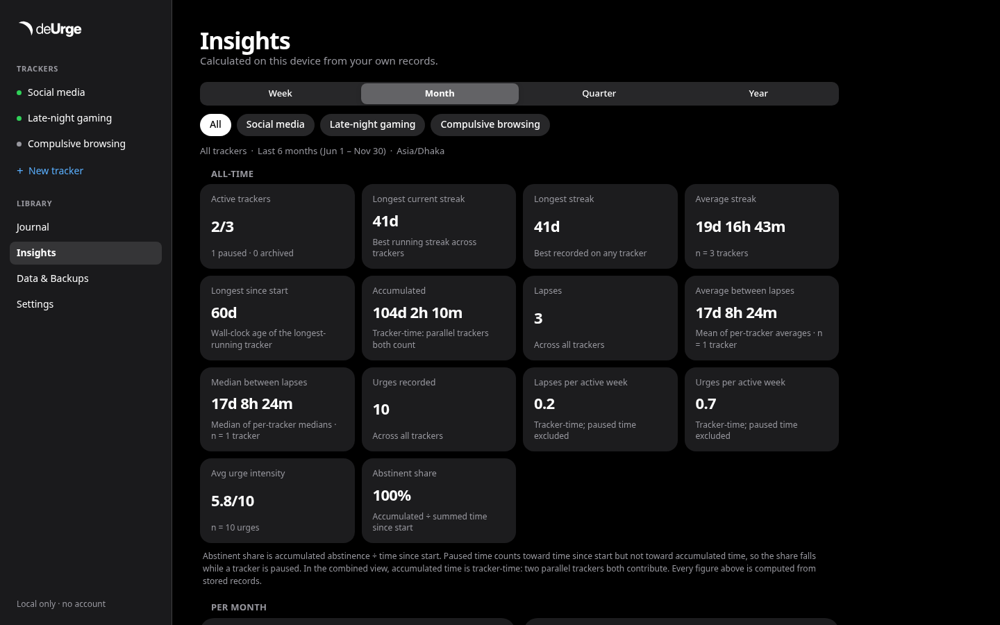

# deUrge

**Progress, not perfection.** A private, local-first tracker for abstinence,
lapses, urges and the progress that continues through all of it.

deUrge is a complete cross-platform application: web/PWA, Android, iOS,
Windows, macOS and Linux. It runs entirely on your device — no account, no
cloud, no tracking, no internet required.

<p align="center">
  
  
  
</p>
<p align="center">
  
  
</p>

> Screenshots are captured from the running app (not mockups). All boards and the
> extracted design tokens are documented in [docs/DESIGN.md](docs/DESIGN.md).

## What it does

- **Multiple independent trackers** for any behaviour you want to stay away
  from. Backdate the start, pause/resume, archive/restore, permanently delete.
- **Indefinite abstinence tracking** with exact elapsed time: current streak,
  longest streak, accumulated abstinence, total elapsed time, pause time,
  lapse counts, average/median time between lapses.
- **Lapses** recorded with timestamp, trigger, reason, context, notes, and a
  retrospective flag. A lapse never erases your history: previous progress stays
  accumulated.
- **Urges** tracked separately with intensity 1–10, duration, trigger and
  outcome. Recording an urge never resets a streak.
- **Journal and activity log**: writing, check-ins and a complete chronological
  history with search and filters.
- **Analytics and insights** computed locally from your actual records, with
  sample sizes and honest “not enough data” states.
- **Continuous progress recognition** derived from real elapsed time — no
  milestones, badges, levels or completion targets anywhere.
- **Ownership**: full JSON export/import, CSV export, encrypted backups
  (PBKDF2 + AES-GCM), merge/replace import with duplicate and conflict
  reporting, and database migrations.

## Privacy promise

| | |
| --- | --- |
| Account | Not required — there is none |
| Internet | Not required, and never used for your data |
| Servers | None |
| Telemetry / analytics / ads | None |
| Cloud sync | Not implemented, by design |
| AI services | None — insights are deterministic local rules |
| Data | Your device, your files |

See [PRIVACY.md](docs/PRIVACY.md) for the full architecture and threat model.

## Tech stack (why this for cross-platform?)

**React 19 + TypeScript + Vite 8 PWA** with **SQLite (WASM via `sql.js`)**,
packaged as:

- **Web/PWA** — Netlify-ready static build, installable, offline after first load.
- **Android/iOS** — Capacitor 8 shell around the same bundle; APK **and** AAB.
- **Windows/macOS/Linux** — Electron shell + **Flatpak** for Linux.

The supplied UI/UX design is HTML-based, so a TypeScript/React stack implements
it faithfully while sharing one tested core across all five platforms. The
domain, streak engine, analytics, insights, import/export and SQLite layer have
zero platform imports and run under Node in the test suite — the tests exercise
the same code that ships. See [ARCHITECTURE.md](docs/ARCHITECTURE.md) for the
full rationale and trade-offs.

## Repository layout

```
apps/web        React PWA (shared UI, Netlify deploy target)
apps/mobile     Capacitor config + Android project (iOS via CI)
apps/desktop    Electron main/preload + electron-builder config
packages/core   @deurge/core: domain, SQLite, services, streak/analytics/
                insights/backup engines (fully unit-tested, platform-free)
flatpak         Flatpak manifest, AppStream metadata, build script
docs            architecture, data model, calculation rules, privacy, backup,
                design references, build/release instructions
```

## Quick start (development)

Requirements: Node ≥ 20.19 and pnpm 10.

```bash
pnpm install
pnpm dev              # web app at http://localhost:5173
pnpm test             # core test suite
pnpm typecheck        # strict TypeScript across the monorepo
pnpm build            # production web build (apps/web/dist)
```

No environment variables, accounts or network services are needed.

## Builds and releases

- **Web / Netlify**: `pnpm build` → publish `apps/web/dist` (config in
  [`netlify.toml`](netlify.toml)). The site is a static PWA.
- **Android APK + AAB**: `pnpm build:android` (requires JDK 21 + Android SDK;
  see [docs/BUILDING.md](docs/BUILDING.md)).
- **Linux Flatpak**: `pnpm build:flatpak`.
- **Windows/macOS/iOS**: Electron/Capacitor projects build on their native
  runners; CI configuration is in [`.github/workflows`](.github/workflows).

Releases are published on the **[Releases page](https://github.com/hello2himel/deUrge/releases/latest)**
with the signed Android APK/AAB, Linux Flatpak, Linux AppImage and a
Netlify-ready web zip attached. Details in [RELEASING.md](docs/RELEASING.md).

```bash
# Android (sideload)
adb install deUrge-1.0.0-release.apk
# Linux
flatpak install --user deUrge-1.0.0-x86_64.flatpak && flatpak run app.deurge.DeUrge
# Web (any static host)
unzip deUrge-1.0.0-web.zip -d deurge-site
```

## Testing

```bash
pnpm test
```

The suite covers streak math (pauses, backdated and out-of-order events,
edits/deletes, restarts, clock changes, timezone/DST/leap-year boundaries),
analytics and distributions, insights sample-size behaviour, JSON/CSV
export/import (merge, replace, duplicates, conflicts, corrupt files, schema
versions), encrypted backups, database constraints/migrations and offline
privacy behaviour. See [ARCHITECTURE.md §9](docs/ARCHITECTURE.md#9-testing-strategy).

## Documentation

- [Architecture](docs/ARCHITECTURE.md)
- [Data model & schema](docs/DATA_MODEL.md)
- [Streak/statistics calculation rules](docs/CALCULATION_RULES.md)
- [Privacy & local-only design](docs/PRIVACY.md)
- [Backup, export, import & recovery](docs/BACKUP_RECOVERY.md)
- [Dependencies](docs/DEPENDENCIES.md)
- [Building for every platform](docs/BUILDING.md)
- [Releasing](docs/RELEASING.md)
- [UI/UX implementation notes](docs/DESIGN.md)

## Data ownership

Everything deUrge knows is in a local SQLite database plus the exports you
create. There is no hidden copy anywhere else. Export a backup regularly from
**Data & Backups**; the file is yours.

## License

[MIT](LICENSE)
